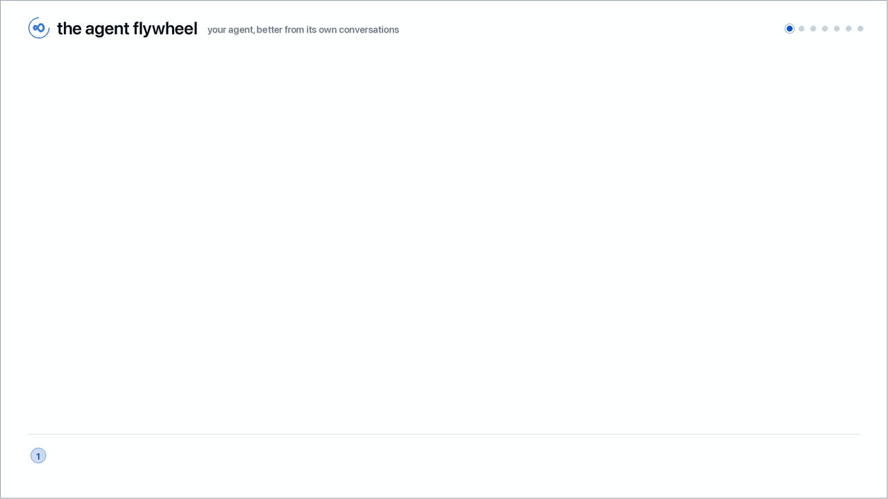

<div align="center">

<!-- lang -->
<!-- FIGURE PATHS ARE RELATIVE, DELIBERATELY — and this is the second time it
     has been settled. They render on GitHub, which is what these GIFs are for.
     Absolute https://raw.githubusercontent.com/... URLs were tried, on the
     reasoning that a registry page cannot resolve a relative path; that broke
     all three figures on github.com instead, because raw.githubusercontent.com
     serves a PRIVATE repo's file to nobody unauthenticated — every reader,
     the owner included. Verified 2026-09-06: all three returned HTTP 404.

     AND THERE IS NO TRADE-OFF LEFT, so nobody has to rediscover it a third
     time: "a registry page cannot resolve a relative path" is wrong for npm,
     which rewrites each relative  src to raw.githubusercontent.com on
     the default branch (seen on the live package page, 2026-09-14). These
     paths render on GitHub now, and on npm the day the repo goes public —
     with no edit here and no new release.

     Held by a test, not by this comment: `test/oss-boundary.test.js` asserts every
      src is relative AND names a file that exists. Shields badges are
     markdown ``, not , and are correctly absolute.

     SHARED WITH THE PYTHON README. Everything outside the lang markers is
     the same text in both repositories, held by test/shared-docs.test.js;
     only what sits between the markers is this package's own. -->

#  Agent Flywheel — Node
<!-- /lang -->

Built and Maintained by **[PerceptEye](https://percepteye.ai)**

### **Your agent gets better at its own job, from its own conversations.**

Your agent keeps running where it runs today, on your credentials, unchanged. We learn from its real conversations, test each new version against its current best, and you approve the winner.

<!-- lang -->
<!-- BADGES — `npm` is the only live-data badge in this README: it reads the
     registry, so it cannot claim a release that never happened. Never swap it
     for a static badge with a hand-written version — that asserts a release
     nothing checks. Every other badge here is a hardcoded shields `/badge/`.
     There is no `ci` badge, and none should be added while this repo is
     private: shields.io queries GitHub anonymously and a private repo 404s
     regardless of what CI did.

     Separately: the `tests` badge below is hardcoded and nothing checks it;
     its 708 was true on 2026-10-13 (it had drifted to 692, 683, 666, 633, 596, 490,
     and before that 373, while the suite grew). Re-derive with `npm test`
     (prints "tests 708" / "skipped 0")
     before trusting it — the Python SDK's equivalent badge had drifted to 54
     short. -->
[](https://www.npmjs.com/package/@percepteye/agent-flywheel)
[](package.json)
[](#-harnesses)
[](#-start)
[](#-development)
[](LICENSE)


<!-- /lang -->

**[Quickstart](docs/quickstart.md)** · [How it gets better](#-how-it-gets-better) · [Start](#-start) · [OpenTelemetry push](docs/otlp.md) · [What reaches us](#-what-reaches-us) · [Docs](#-docs)

</div>

---

## 🔁 How it gets better

1. **We learn from your agent's real conversations.** The SDK records what your users asked, what the model saw, what the tools did and what your agent answered, and sends it to us once you allow it.
2. **Each new version is tested against your agent's current best,** on conversations it has never seen.
3. **You approve the winner in Decisions.** Nothing reaches your users before that.
4. **The next round starts from the best so far.** Run it again whenever new conversations have arrived.

No container to build, no cluster to run, no GPU to provision and no inbound port to open. Every connection is opened from your side.

## ⚡ Start

<!-- lang -->
```bash
openclaw plugins install @percepteye/agent-flywheel     # zero runtime dependencies
```

```bash
export PERCEPTEYE_AGENT_MODE=production
export PERCEPTEYE_AGENT_ID=support-agent      # the name you gave the agent in the dashboard
```

```jsonc
// your OpenClaw config: lets the plugin read the conversation
{ "plugins": { "entries": { "agent-flywheel": {
    "hooks": { "allowConversationAccess": true } } } } }
```
<!-- /lang -->

[Get your key](docs/dashboard.md#get-your-key), and put it in your agent's environment with the control-plane URL shown beside it:

```bash
export PERCEPTEYE_CONTROL_PLANE_URL=https://launch.percepteye.ai/api/flywheel/v1
export PERCEPTEYE_API_KEY=pefw_...
```

Start your agent, give it [permission to learn from its conversations](docs/dashboard.md#allow-us-to-learn-from-its-conversations), and [start improving](docs/dashboard.md#start-improving). The [Quickstart](docs/quickstart.md) walks through it, including when your first trace appears.

## 🧩 Harnesses

<!-- lang -->
| your agent | what the plugin records | your code |
|:--|:--|:--|
| **OpenClaw** | conversations, model calls, and every tool call's outcome; practice tasks in training mode; applies the approved prompt and model in production mode | none: install the plugin, set `hooks.allowConversationAccess` |
| **DeepSeek Harness** | every tool call's outcome | none: `dsh plugin --profile <name> add @percepteye/agent-flywheel` |

The plugin has zero runtime dependencies, and no hook it registers can change a tool result.
<!-- /lang -->

Running something else that exports OpenTelemetry traces? [Push them](docs/otlp.md), with nothing to install.

## 📤 Already on OpenTelemetry?

Send us the traces your agent already exports, as a second destination. With an OpenTelemetry Collector you add us as one more exporter, and your current destination keeps receiving everything. → [OpenTelemetry push](docs/otlp.md)

## 🎯 Practice tasks

Your agent can also work through practice tasks we write from its own tools and system prompt, graded as it goes. You [start them](docs/dashboard.md#run-practice-tasks) from your agent's page.

<!-- lang -->
<p align="center">
  
</p>

In training mode, the default, the plugin claims practice tasks and runs each in its own `percepteye-rollout-*` session, never one you are using. Training mode needs `hooks.allowConversationAccess: true`; `PERCEPTEYE_AGENT_MODE=production` claims none. → [Reference](docs/reference.md#two-modes-one-switch)
<!-- /lang -->

## 🔒 What reaches us

- **Nothing, until you allow it.** Conversations are sent only once an organization admin switches on the agent's [permissions](docs/dashboard.md#allow-us-to-learn-from-its-conversations). Until then they stay on your disk.
- **Personal data is found, and never learned from.** We scan everything we receive. In tool-call records a match is masked; in messages and what the model saw, the turn is kept as sent and never learned from.
- **Nothing is deleted unless you ask**, and your own copy on your machine is yours. → [What data do you keep?](docs/faq.md#what-data-do-you-keep-and-for-how-long)
- **Never your code, and never your credentials.** Your agent runs where it runs today.

## ✋ A person approves every change

- **A new version reaches Decisions only after it has beaten your agent's current best** on conversations it has never seen. You approve it or reject it there; until you approve, your agent keeps the version it has.
- **No language model can approve anything.** Promoting a model and delivering a prompt are irreversible decisions: only the explicit approve and reject controls resolve them. A reply like "sure, go ahead" is recorded as an answer, never as an approval.
- **The SDK checks too.** It refuses a model whose address is a stored file (`gs://`, `s3://`, `file://`) rather than a running endpoint, and a prompt that a person did not approve or that was approved against a different model.

<!-- lang -->
In production mode the plugin applies the approved prompt and model to this agent's own turns and nothing else; `PERCEPTEYE_APPLY_PROMPT=0` and `PERCEPTEYE_APPLY_MODEL=0` switch each half off. → [Production](docs/production.md#run-the-approved-version)
<!-- /lang -->

## 🐍 Python or Node?

Pick the one that matches where your agent runs. Never both for one agent.

| | Python SDK | Node plugin |
|:--|:--|:--|
| **for** | a Python agent, or a command-line agent you launch yourself | an OpenClaw or DeepSeek Harness agent |
| **install** | `pip install agent-flywheel` | `openclaw plugins install @percepteye/agent-flywheel` |
| **the approved model and prompt** | handed back for your code to apply | applied for you, in production mode |
| **repository** | [`agent-flywheel`](https://github.com/percepteye-ai/agent-flywheel) | [`agent-flywheel-node`](https://github.com/percepteye-ai/agent-flywheel-node) |

## ⚙️ Configuration

<!-- lang -->
| config key | environment variable | default | meaning |
|:--|:--|:--|:--|
| `apiKey` | `PERCEPTEYE_API_KEY` | *(none)* | your agent's key. Without it nothing leaves the machine |
| `controlPlaneUrl` | `PERCEPTEYE_CONTROL_PLANE_URL` | `https://launch.percepteye.ai/api/flywheel/v1` | the control-plane URL |
| `agentId` | `PERCEPTEYE_AGENT_ID` | `openclaw` | the agent id this install reports as, and whose approved prompt and model it applies |
| `mode` | `PERCEPTEYE_AGENT_MODE` | `training` | `training` claims practice tasks; `production` claims none, captures the turns you serve and applies the approved pair |
| `capture` | `PERCEPTEYE_CAPTURE` | on | `0` registers no hook and records nothing |
| `applyPrompt` · `applyModel` | `PERCEPTEYE_APPLY_PROMPT` · `PERCEPTEYE_APPLY_MODEL` | on | `0` leaves the system prompt, or the model, alone |

Config is `plugins.entries.agent-flywheel.config` in your OpenClaw config, and wins over the environment. Every setting is in the [Reference](docs/reference.md#configuration).
<!-- /lang -->

## 📚 Docs

- [Quickstart](docs/quickstart.md): from install to your first trace, then to improving.
- [Production](docs/production.md): what is sent and when, retries, rate limits and personal data.
- [OpenTelemetry push](docs/otlp.md): send the traces your agent already exports.
- [In the dashboard](docs/dashboard.md): every click path, in one place.
- [FAQ](docs/faq.md) and [Troubleshooting](docs/troubleshooting.md).
<!-- lang -->
- [Reference](docs/reference.md): every setting, the harnesses, what each hook does, and what the plugin writes.
<!-- /lang -->

## 🛠 Development

<!-- lang -->
```bash
npm test     # 708 tests, no install step — node:test, zero dependencies
```

The suite includes payloads captured verbatim from a live OpenClaw run (`test/host-fixtures.test.js`). If a future OpenClaw changes the shape, those fail — rather than someone discovering it months later from bad training data. One test compares the shared pages with the Python SDK's; it runs when a checkout of that repository sits beside this one, as `percepteye-agent-flywheel`.

[`schema/flywheel-1.json`](schema/flywheel-1.json) is the wire contract, shared with the Python SDK, and a test asserts this package's wire types match it.
<!-- /lang -->

---

**Contributing** — issues and PRs welcome; a new adapter must not import its framework at module scope, must report `unknown` rather than guess, and must fail loudly at bind time. ·
**Security** — please report vulnerabilities privately to **security@percepteye.ai**. ·
**License** — [MIT](LICENSE) © PerceptEye.
