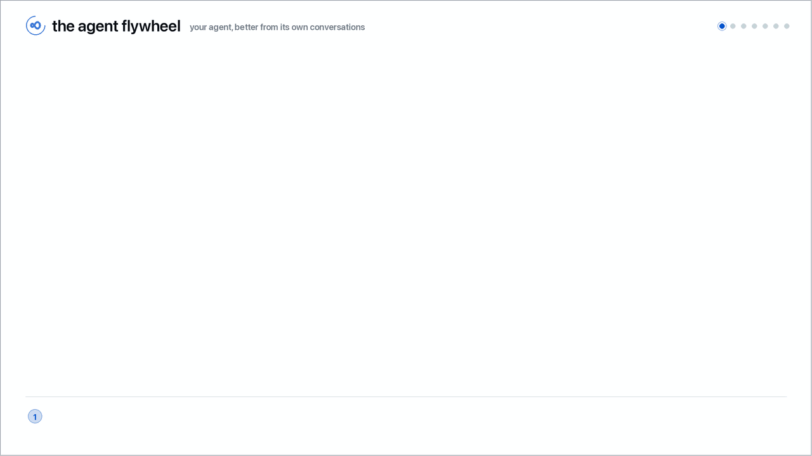
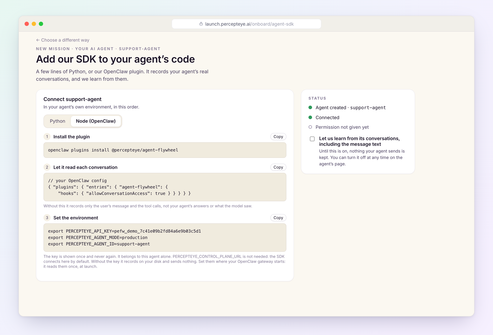
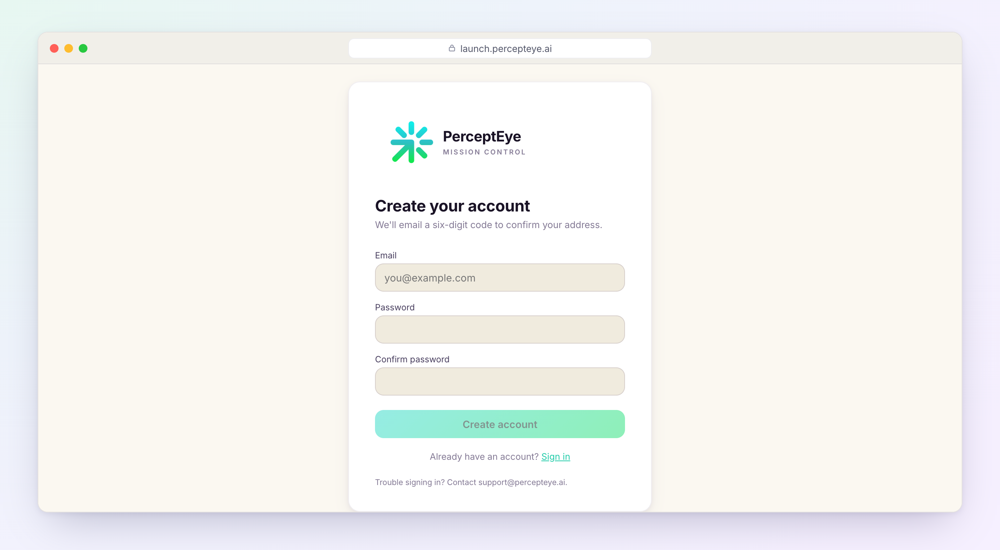
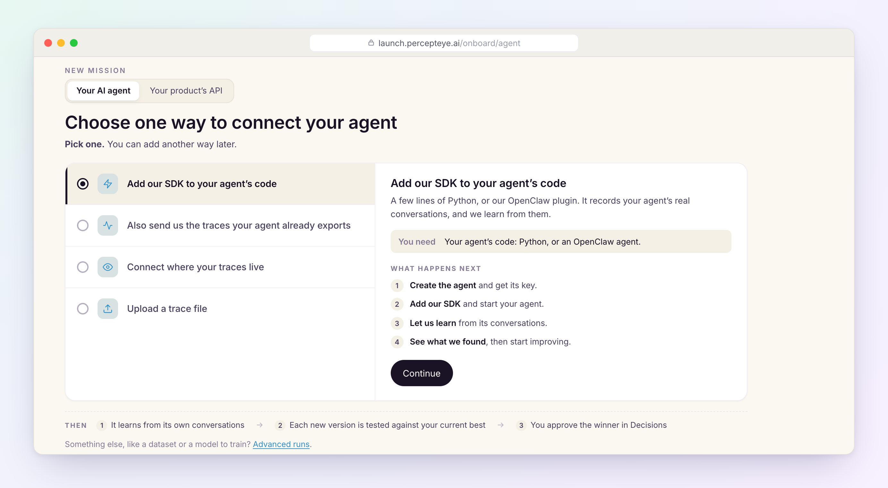
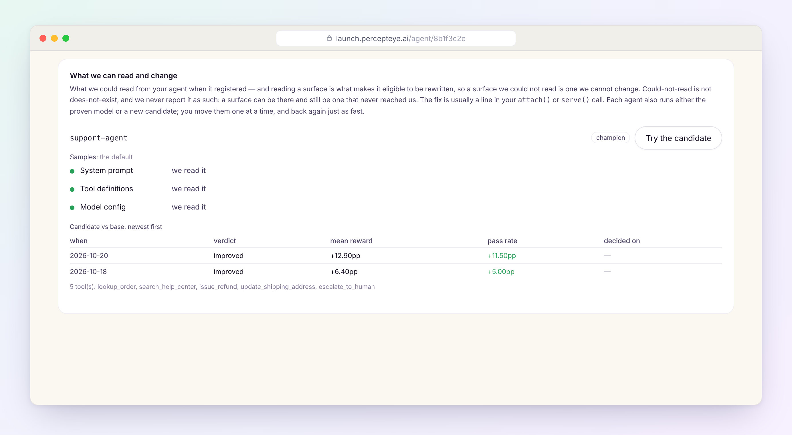

<div align="center">

<!-- FIGURE PATHS ARE RELATIVE, DELIBERATELY — and this is the second time it
     has been settled. They render on GitHub, which is what these GIFs are for.
     Absolute https://raw.githubusercontent.com/... URLs were tried, on the
     reasoning that a registry page cannot resolve a relative path; that broke
     all three figures on github.com instead, because raw.githubusercontent.com
     serves a PRIVATE repo's file to nobody unauthenticated — every reader,
     the owner included. Verified 2026-09-06: all three returned HTTP 404.

     AND THERE IS NO TRADE-OFF LEFT, so nobody has to rediscover it a third
     time: "a registry page cannot resolve a relative path" is wrong for npm,
     which rewrites each relative  src to raw.githubusercontent.com on
     the default branch (seen on the live package page, 2026-09-14). These
     paths render on GitHub now, and on npm the day the repo goes public —
     with no edit here and no new release.

     Held by a test, not by this comment: `test/oss-boundary.test.js` asserts every
      src is relative AND names a file that exists. Shields badges are
     markdown ``, not , and are correctly absolute. -->

#  Agent Flywheel — Node

Built and Maintained by **[PerceptEye](https://percepteye.ai)**

### **Your agent gets better at its own job, on its own work, without you writing a training pipeline.**

**For any JavaScript or TypeScript agent: the Vercel AI SDK, LangChain.js, LangGraph.js, Mastra, the OpenAI SDK, or your own code.**<br/>
One `npm install`. Zero runtime dependencies. It keeps running where it runs today, behind your firewall, on your credentials.

<!-- BADGES — `npm` and `ci` are the live-data badges in this README. `npm`
     reads the registry, so it cannot claim a release that never happened;
     `ci` asks GitHub for the latest ci.yml run on main. Never swap either for
     a static badge with a hand-written value — that asserts a state nothing
     checks. Every other badge here is a hardcoded shields `/badge/`.

     Separately: the `tests` badge below is hardcoded and nothing checks it;
     its 1267 was true on 2026-11-21 (it had drifted to 1243, 1213, 1203, 1012, 1001, 989, 983, 944, 862, 861, 859, 850, 829, 826, 781, 780, 773, 763, 749, 745, 729, 725, 683, 666, 633, 596, 490,
     and before that 373, while the suite grew). Re-derive with `npm test`
     (prints "tests 1267" / "skipped 0", with the Python SDK checkout found)
     before trusting it — the Python SDK's equivalent badge had drifted to 54
     short. -->
[](https://github.com/percepteye-ai/agent-flywheel-node/actions)
[](https://www.npmjs.com/package/@percepteye/agent-flywheel)
[](package.json)
[](types/index.d.ts)
[](#-why-it-earns-its-place)
[](#-develop)
[](LICENSE)

<br/>

[](https://launch.percepteye.ai/onboard/agent-sdk)

<sub>Hosted control plane · free plan · no credit card · your first key in about a minute</sub>



**[Install](#-install)** · [Frameworks](#-frameworks) · [Control plane](#-the-control-plane) · [How the loop closes](#-how-the-loop-closes) · [Modes](#-two-modes-one-switch) · [Production observability](#-production-observability) · [OpenTelemetry push](#-already-on-opentelemetry-push-your-spans-instead) · [Human approval](#-a-person-approves-every-change) · [Configuration](#%EF%B8%8F-configuration) · [OpenClaw and DeepSeek Harness](#-openclaw-and-deepseek-harness) · [Python or Node?](#-python-or-node)

</div>

---

**Your agent already does real work. This turns that work into training data, and hands back a model trained on it.**

No container to build. No cluster to run. No GPU to provision. No inbound port to open. No labelling team. No eval suite to write. Wrap the turn your agent already serves in one call; the SDK records what its tools actually did and feeds a control plane that does the post-training for you.

<br/>

## ⚡ Install

```bash
npm install @percepteye/agent-flywheel
```

Node 22.22.3 or later. Zero runtime dependencies, and TypeScript declarations included. Then get the agent's key: sign up at **[launch.percepteye.ai](https://launch.percepteye.ai/onboard/agent-sdk)**, name the agent and pick Node. The key is shown once and is scoped to that one agent.

```bash
export PERCEPTEYE_API_KEY=pefw_...        # from https://launch.percepteye.ai/onboard/agent-sdk
export PERCEPTEYE_AGENT_ID=support-agent  # the name you gave the agent there
```

**Or get the key without leaving your terminal:**

```bash
npx @percepteye/agent-flywheel login --agent-id support-agent
```

It prints a short code and opens launch.percepteye.ai with the code filled in. Sign up or sign in, check that the code matches, and click **Approve**. The key comes back to the terminal and is stored in `~/.percepteye/credentials.json` (or `$PERCEPTEYE_HOME/credentials.json`), readable only by you, for that one agent on that one control plane. When neither `apiKey` nor `PERCEPTEYE_API_KEY` is set, the SDK uses the stored key for its `agentId` and logs once that it is doing so. A stored key is consent to send, exactly as the variable is. `npx @percepteye/agent-flywheel logout --agent-id support-agent` forgets it here; revoking it in Mission Control (Settings) stops it everywhere. The Python SDK's `agent-flywheel login` writes the same file, so either one serves both.

Without a key nothing leaves the machine: the SDK still records your agent's real tool-failure rate locally, with no account.

<!-- THE KEY ROUTE, confirmed by the owner 2026-09-14 and re-pointed
     2026-10-20: PerceptEye operates the control plane, and sign-up is free and
     self-serve. Every link on this page that asks for a key goes to
     https://launch.percepteye.ai/onboard/agent-sdk, the dashboard's screen for
     connecting an agent with the SDK, which is also the SIGN_UP_URL this
     package's own missing-key lines print (src/config.js). The Python README
     says the same; keep the two in step. -->

### 1 · Wrap each turn you serve

```ts
import { flywheel } from "@percepteye/agent-flywheel";

const fw = flywheel({ agentId: "support-agent", framework: "ai-sdk" });

app.post("/chat", async (req, res) => {
  const answer = await fw.turn(req.body.message, (t) => runAgent(t), {
    conversationId: req.body.conversationId,
  });
  res.json({ answer });
});

process.on("SIGTERM", () => fw.close());   // sends what is waiting, bounded
```

`fw.turn(input, fn)` runs your agent and returns what it returns. It records the user's message, every tool call, and the answer. A person can approve a better system prompt and model for the agent, and `fn` is then handed both: `t.systemPrompt(yours)` returns the approved prompt (or yours), and `t.model` is the approved endpoint (or `null`, so keep yours). `runAgent` is your agent with three lines changed:

```ts
import { generateText, stepCountIs, wrapLanguageModel } from "ai";
import { createOpenAI } from "@ai-sdk/openai";
import { flywheelMiddleware, flywheelTools } from "@percepteye/agent-flywheel/ai-sdk";
import type { FlywheelTurn } from "@percepteye/agent-flywheel";

async function runAgent(t: FlywheelTurn) {
  const provider = t.model
    ? createOpenAI({ baseURL: t.model.baseURL, apiKey: t.model.apiKey ?? undefined }).chat(t.model.model!)
    : createOpenAI().chat("gpt-4.1-mini");                                     // your own model
  const { text } = await generateText({
    model: wrapLanguageModel({ model: provider, middleware: flywheelMiddleware() }),
    system: t.systemPrompt("You are a support agent for Acme."),                 // yours, or the approved one
    tools: flywheelTools(tools),                                                 // records every call
    prompt: t.input,
    stopWhen: stepCountIs(8),
    abortSignal: t.signal,
  });
  return text;
}
```

### 2 · Let it practise

The same function runs the graded tasks the control plane writes for your agent from its real tools. Run it in a separate process pointed at a test or sandbox backend, because rollouts are real runs on your real tools:

```ts
// PERCEPTEYE_AGENT_MODE=training node train.js
const fw = flywheel({ agentId: "support-agent", framework: "ai-sdk" });
await fw.serve(runAgent, { maxRollouts: 8 });
```

`fw.serve(fn)` claims one task at a time and hands it to `fn` as `t.input`. In a rollout, `t.model` is always set: it is the checkpoint being trained, served through that rollout's own gateway, and **your agent must call it**. A rollout answered by any other model would be scored as the checkpoint's. Then `fw.serve` reports the answer, the tool calls and an independently observed count of the model calls. A call that throws is reported as a failed attempt, never dropped. `t.signal` aborts if the control plane revokes the rollout or its deadline passes. `fw.serve` resolves after `maxRollouts`, when its `signal` aborts, or on `fw.close()`.

> [!IMPORTANT]
> **Training takes two switches, one on each side.** `PERCEPTEYE_AGENT_MODE=training` on this process says it may run practice tasks. **Allow practice runs** on the agent in Mission Control (an org admin) says the platform may send them. With either off, no practice task runs: `fw.serve()` refuses in production mode and names the switch, and the startup line names Mission Control's half when that one is off.

<br/>

## 🧩 Frameworks

| framework | what you add | records tool outcomes | describes the agent (prompt, tools, model) |
|:--|:--|:--|:--|
| **Vercel AI SDK** (`ai` 5, 6, 7) | `flywheelTools(tools)` and `flywheelMiddleware()` from `@percepteye/agent-flywheel/ai-sdk` | ✅ | ✅ |
| **LangChain.js / LangGraph.js** (`@langchain/core` 0.3, 1.x) | `callbacks: [flywheelCallbacks()]` from `@percepteye/agent-flywheel/langchain` | ✅ | ✅ |
| **OpenAI SDK, Anthropic SDK, Mastra, your own loop** | `t.recordToolCall({...})` where your tools run | ✅ | with [`describe`](#%EF%B8%8F-configuration) |
| **OpenClaw, DeepSeek Harness** | the plugin: [OpenClaw and DeepSeek Harness](#-openclaw-and-deepseek-harness) | ✅ | prompt and model; tools with `describe` |

Neither adapter imports its framework: both are plain objects in the shapes the framework already accepts, so they add no dependency and no version pin. Both were tested against the real packages, on the versions above.

**LangChain.js and LangGraph.js.** Create the handler inside the turn, so it is bound to that turn:

```ts
import { ChatOpenAI } from "@langchain/openai";
import { createAgent } from "langchain";
import { flywheelCallbacks } from "@percepteye/agent-flywheel/langchain";

const answer = await fw.turn(message, async (t) => {
  const model = t.model
    ? new ChatOpenAI({ model: t.model.model!, apiKey: t.model.apiKey ?? undefined,
                       configuration: { baseURL: t.model.baseURL } })
    : new ChatOpenAI({ model: "gpt-4.1-mini" });
  const agent = createAgent({ model, tools, systemPrompt: t.systemPrompt("You are a support agent for Acme.") });
  const out = await agent.invoke({ messages: [{ role: "user", content: t.input }] },
                                 { callbacks: [flywheelCallbacks()], signal: t.signal });
  return String(out.messages.at(-1)?.content ?? "");
});
```

**Anything else.** Record each tool call where it runs. Say the outcome when you know it, because only you can know that an HTTP 200 was a permission denial:

```ts
import { recordToolCall } from "@percepteye/agent-flywheel";

const started = performance.now();
const res = await fetch(`${API}/refunds`, { method: "POST", body: JSON.stringify({ orderId }) });
const reply = await res.json();
recordToolCall({
  name: "issue_refund", arguments: { orderId },
  outcome: reply.denied ? "failed" : "ok", statusCode: res.status,
  result: reply, latencyMs: performance.now() - started,
});
```

`recordToolCall` is a no-op outside a turn, so it can stay in code that also runs outside the flywheel. Leave `outcome` out and it is read from `error` and `result`: an error is `failed`, and a returned value is `unknown`, never `ok`. A returned value does not prove the side effect landed.

**What is observed, exactly.** The adapters record each tool's arguments, outcome, latency and call id, plus any entity id its result names (`{"id": "ord_9f8e…"}`), never the result itself. The model input is reported once per turn: the system prompt, the prompt, the history, the tool definitions and the model. Outside a turn both adapters pass everything through untouched.

<br/>

## 🎯 What you get

| | |
|:--|:--|
| 🔁 **A continual-learning loop** | your agent runs graded tasks, its real outcomes go back, and the next model is trained on *this agent's* work — not a generic benchmark |
| 🤖 **Autonomous post-training** | task generation, grading, dataset construction, training and promotion happen on our side. You build none of it |
| 🧪 **Honest discovery** | the adapters report the system prompt, the tools and the model your agent actually sends. What nothing observes stays explicitly unknown instead of being invented — until you declare it with [`describe`](#%EF%B8%8F-configuration) |
| 📈 **Honest telemetry on day one** | your agent's true tool-failure rate, recorded locally, with **no account and no network** |
| 📡 **Production observability** | capture the turns you actually serve — the user's message, the tool calls, the answer — and turn live traffic into evidence |
| 🧬 **A prompt that keeps evolving** | [prompt optimization](#-prompt-optimization-an-evolving-system-prompt) evolves your system prompt from this agent's own traces and keeps improving it as new traces arrive, even while the last improvement awaits approval |
| ✅ **The approved pair, applied** | training co-optimizes a system prompt alongside the model. Once *a person on your side approves each*, your production turns get **both** — the prompt, and the checkpoint it was certified with. No redeploy; one switch each to stop |
| 🙋 **A person approves every change** | nothing reaches your agent that a human with the operator role did not approve through an explicit control. Not a percentage rollout, not an automated promotion, and never a language model reading "sure, go ahead". [How that is enforced](#-a-person-approves-every-change) |
| 🛡️ **It never touches a tool result** | the adapters observe a tool call after it ran and return its result untouched. The two things this SDK hands your agent are a system prompt and a model — in production, approved bundles only, through `t.systemPrompt()` and `t.model`, off with [`PERCEPTEYE_APPLY_PROMPT=0` / `PERCEPTEYE_APPLY_MODEL=0`](#-two-modes-one-switch); in training, the rollout's own gateway (the checkpoint being trained) |

<br/>

## 🌐 The control plane

<!-- SCREENSHOTS (docs/assets/control-plane-*.png): the dashboard's own
     onboarding and agent-page components, from the dashboard's code as of
     2026-10-20 (the release that follows the one live that day), rendered
     over SAMPLE data. The agent
     "support-agent", its pefw_demo_ key and its scores are illustrative, and
     the caption says so. Re-take them when those screens change: a picture of
     a screen that no longer exists sends a new user looking for it. -->

Installing the SDK is half of the flywheel. **The other half writes the tasks, grades every rollout and trains the model. That half is the control plane at [launch.percepteye.ai](https://launch.percepteye.ai/onboard/agent-sdk).** PerceptEye runs it on PerceptEye's GPUs, so there is nothing for you to deploy, scale or keep on call. It is also where you watch every lap, and where you approve what ships.

<p align="center">
  <a href="https://launch.percepteye.ai/onboard/agent-sdk"></a>
  <br/><sub>Connecting an agent at launch.percepteye.ai. The screens on this page show a sample agent.</sub>
</p>

| | **the SDK** · this package | **the control plane** · launch.percepteye.ai |
|:--|:--|:--|
| **runs** | in your process, beside your agent | hosted by PerceptEye |
| **does** | records every tool outcome, claims rollouts in training mode, captures the turns you serve, applies the approved prompt and model | writes tasks from your agent's real tools, grades every rollout, trains the policy, measures each candidate against the model you run today |
| **shows you** | one startup line | every agent, what it could read of each, every candidate against the champion, and the switch that moves an agent between them |
| **you bring** | `npm install @percepteye/agent-flywheel` and one wrapped call | an email address |

**A key joins the two halves.** Without one, the SDK records on your disk and sends nothing. That part is free forever and needs no account. With a key, the same install registers your agent, works rollouts and picks up what training produced. Its startup line says which state it is in, and names the page where you get a key.

<table>
  <tr>
    <td width="33%" valign="top">
      <br/>
      <b>① Create a workspace.</b> An email, a password and a six-digit code. Free plan, no credit card.
    </td>
    <td width="33%" valign="top">
      <br/>
      <b>② Connect your agent.</b> Choose the SDK, pick <i>Node</i>, name the agent and get its <code>pefw_</code> key, shown once and scoped to that one agent.
    </td>
    <td width="33%" valign="top">
      <br/>
      <b>③ Watch, then approve.</b> Every candidate is measured against the model you run today. Nothing moves until a person clicks <i>Try the candidate</i>, and moving back is the same click.
    </td>
  </tr>
</table>

<br/>

## 🔁 How the loop closes

<p align="center">
  
</p>

| beat | what happens | who does the work |
|:--|:--|:--|
| **⓪ Describe** | the adapters report the system prompt, tools and model your agent sends; what they cannot see you can [declare](#%EF%B8%8F-configuration) | automatic, never invented |
| **① Claim** | a training process registers, then claims one graded task at a time | you dial out — no inbound port |
| **② Run** | `fw.serve` hands the task to your agent function, pointed at the checkpoint being trained | your agent, unchanged |
| **③ Record** | every executed tool call lands as `ok` / `failed` / **`unknown`** | the adapters, or `recordToolCall` |
| **④ Report** | the answer, the tool calls and the observed model-call count go back; unsupported evidence stays absent | the SDK |
| **⑤ Train** | tasks generated, rollouts graded, dataset built, policy trained and promoted | **PerceptEye — you build none of it** |
| **⑥ Serve** | the approved system prompt **and** the model it was certified with reach your production turns as `t.systemPrompt()` and `t.model`, once a person has approved each | the SDK |

That last beat is what makes it a flywheel rather than a pipeline: **the better agent generates the better evidence.**

**The prompt keeps improving after you approve it.** Mission Control goes on evolving the system prompt from the traces your agent keeps producing, including while a person has not yet decided the last improvement. Each round has to beat the candidate already waiting, so whatever is approved next is the best prompt found so far. At most once per `ttl_s` (never faster than 30 s) a turn re-reads `/policy/current` without waiting for it; only a newer `prompt_generation` fetches new text. The turn that noticed keeps its prompt, and the next turn runs the new one. An empty or failed read never takes an applied prompt away.

**The model-call count is the SDK's to make, not yours.** Mission Control trains on a rollout only when two independent counts of its policy calls agree: what its gateway saw, and what the agent side observed. While `fw.serve` runs, every request your process makes to the rollout's own model URL through `fetch` is counted from its start to its response — the OpenAI SDK, the Vercel AI SDK and LangChain.js all use it (each was checked against a real gateway count). A rollout with no observed call is reported with no count, never a claimed zero, and is held out of training.

<br/>

## 🎚 Two modes, one switch

Everything beyond local recording is decided by `PERCEPTEYE_AGENT_MODE` (or the `mode` option).

```bash
export PERCEPTEYE_AGENT_MODE=production   # the default: the process serving your users
export PERCEPTEYE_AGENT_MODE=training     # a separate process that runs practice tasks
```

| | `production` (default) | `training` |
|---|---|---|
| Records tool outcomes locally | yes | yes |
| Alters a tool result | **never** | **never** |
| `fw.serve()` claims and runs rollouts | **refuses**, naming the switch | yes |
| Captures the turns you serve | yes | no |
| Uploads them | only once an operator enables it | n/a |
| **`t.systemPrompt()` returns the approved prompt** | **yes** — off with `PERCEPTEYE_APPLY_PROMPT=0` | **no**: a rollout is evidence about the agent as configured |
| **`t.model` is the approved model** | **yes** — off with `PERCEPTEYE_APPLY_MODEL=0` | it is the rollout's own gateway: the checkpoint being trained |

**`production` is not "observe-only".** Handing your agent an approved prompt and model changes what it does, which is the point of beat ⑥. What it guarantees absolutely is that it **claims no work and starts no turn**.

**Training is always an explicit choice, and it takes two switches**: this mode, and **Allow practice runs** on the agent in Mission Control. A training process runs our tasks through your agent's real tools, so point it at a test or sandbox backend.

These are off switches, each also an option of `flywheel()` (`capture`, `applyPrompt`, `applyModel`):

```bash
export PERCEPTEYE_CAPTURE=0        # record nothing, claim nothing
export PERCEPTEYE_APPLY_PROMPT=0   # keep recording, leave the system prompt alone
export PERCEPTEYE_APPLY_MODEL=0    # keep recording, leave the model alone
```

<br/>
## 📡 Production observability

In `production` mode `fw.turn()` records the turns your agent is already serving — one directory per turn, in the same on-disk format the Python SDK writes:

```
$PERCEPTEYE_CAPTURE_DIR/<turnId>/      # default ~/.percepteye/captured/<agentId>
    turns.jsonl        {"kind":"task"|"answer","text","turn_id","conversation_id","task_id"}
    conversation_id
    task_id            # optional caller-authored case/work-item correlation
    task_id.conflict   # present only when writers disagreed; task_id is then omitted
    tool_calls.jsonl
    genai_observation.jsonl   # only under the model-content tier, see below
```

`task_id` is opaque correlation evidence only. The SDK never interprets it as
success, reward, a hint, policy identity, or permission to train. Pass it as
`fw.turn(input, fn, { taskId })`. Invalid
or conflicting values are omitted rather than cleaned into another identifier;
valid task-only turns still reach the control plane for downstream validation.

**Uploading is off until an operator turns it on, per agent.** A production turn carries *your end users'* messages, so the default cannot be to send them. With a key set, the SDK registers this agent with the control plane at startup — that is what makes it appear so an operator can enable capture — then asks a plain read whether it may upload. It never learns its permission by uploading and finding out. Once enabled, turns go up every 32 turns and again at `fw.close()`; while the answer is still no, each of those flushes re-reads it, so a grant made after startup is picked up without a restart. If the control plane refuses a batch of turns (an operator withdrew consent, or the key lost its scope), the SDK stops uploading and stops recording model content, says why in the control plane's words, and keeps the turns on disk until consent is granted again.

Recording itself is unaffected by any of that: it never leaves the machine, and works with no account at all.

**Then say how the turn turned out.** `fw.reportOutcome` is the Python SDK's `report_outcome` under this package's casing:

```ts
fw.reportOutcome("resolved", { turnId });                         // this turn settled it (t.turnId)
fw.reportOutcome("reopened", { conversationId,                    // ...or the whole conversation,
  value: 129.5, note: "refund re-requested" });                    // with a number and a short note
```

The outcome is one of `resolved`, `escalated`, `reopened`, `abandoned`, `thumbs_up`, `thumbs_down` (`PRODUCTION_OUTCOMES`); anything else throws `InvalidOutcome` where you wrote it. `turnId` is the id the turn was captured under (`t.turnId`, or the one you passed to `fw.turn`). Name it, the `conversationId`, or both, and report as many as happen — resolved today and reopened next week are two outcomes, and neither replaces the other. `value` is an optional number, `note` an optional remark of at most 1,000 characters (the control plane masks personal data in it before storing it), `occurredAt` (a `Date` or RFC 3339 string) defaults to now, and `outcomeId` is the idempotency key if you want your own. It follows the turn in every way that matters: **it is a no-op once the control plane says capture is not enabled for the agent** (it returns `null` and keeps nothing; reported before that answer is known, it is kept — at most 1,000 of them, oldest dropped first, with a warning saying the control plane has not answered — and the upload asks again), and once enabled it is queued as one `.outcome.<digest>.json` file in the capture directory, uploaded without being awaited, retried until the control plane acknowledges it (for up to a week, across restarts) — except a record the control plane refuses by name, which is dropped with a warning while the rest of its batch is sent — and stopped by the same refusal that stops turns. An outcome is your report of what happened next — a weak label the platform keeps beside the turn, not a grade, and nothing is trained on it directly.

**An episode the platform ran has outcomes too.** In a rollout, `t.rolloutId` is the episode's id. Outcomes travel with production capture, so the production process that later sees what happened reports them, naming the episode (a training process says once that it sent nothing):

```ts
fw.reportOutcome("resolved", { episodeId });                      // how the whole episode turned out
fw.reportTurnFeedback("corrected", { episodeId, turnIndex: 3 });  // what the user did with one turn of it
```

`episodeId` is one more thing an outcome can name, alone or beside a `turnId` or `conversationId`. `reportTurnFeedback` is the Python SDK's `report_turn_feedback`: one word from a closed vocabulary — `accepted`, `corrected`, `repeated`, `escalated`, `abandoned` (`TURN_FEEDBACK_SIGNALS`) — and anything else throws `InvalidFeedback` naming the five. It returns the feedback's id (`feedbackId` is the idempotency key if you want your own; `occurredAt` defaults to now) and is queued as one `.feedback.<digest>.json` file, uploaded without being awaited and retried exactly as an outcome is. Neither is your end users' production traffic, so **neither waits for production capture to be enabled**: an outcome naming only an episode, and all feedback, are sent as soon as the SDK has a key. Both are weak labels — kept beside the episode's evidence as readings, never a grade. No answer of the control plane reaches your code. Per-turn feedback follows the outcomes' rules: a report the control plane refuses — in a 4xx, or by name inside a 200 (`accepted: false`) — is dropped alone, named in one warning with the control plane's own word, and the rest of its batch is sent; a 403 (a key without the scope) stops sending for that process and keeps what is waiting on disk; a 401 or 410 keeps it for a later flush. Only a control plane with no feedback route at all (a 404 or 405: it predates it) has what was waiting dropped, said once, and no more sent by that process. A control plane whose episode intake is switched off answers 503 with a Retry-After: the request is retried as the header says, and what is waiting stays for a later flush. An id or a note holding a lone surrogate throws where you wrote it, as the control plane would refuse it.

**Feedback on a production turn is uploaded and rides its trace.** A production turn has no episode, so `fw.reportTurnFeedback("corrected", { turnId })` names it by the id it was captured under instead. It is queued and uploaded like an episode's (`POST /turn-feedback` takes a production turn by its `turn_id`), and it also goes where an OTLP-exported turn went: your TracerProvider (with `@opentelemetry/api` installed). The turn's span has ended by the time its user acts, and an ended span takes no event, so the SDK records a span of its own, `percepteye.turn.feedback`, LINKED to the turn's spans (OpenTelemetry's relation between causally related spans that are not parent and child) and carrying the turn's `percepteye.turn.id`, with one event: `percepteye.turn.feedback` at `occurredAt`, attributes `percepteye.turn.feedback.signal` and `percepteye.turn.feedback.id`. It starts a trace of its own. An OTLP export of your traces to the control plane delivers it with the turn. It returns the feedback's id once it is queued or that span is recorded, and `null` when neither happened. Name a turn one way: `turnId`, or `episodeId` and `turnIndex`. The Python SDK's `report_turn_feedback(..., turn_id=)`, the same upload and the same span.

**What your model saw is a second, separate opt-in, also off by default.** With the model-content tier granted for the agent, the SDK also records each turn's model boundary — the system prompt, the history, the prompt and the tool definitions the adapters reported, and the answer — and the turn uploads it as one [OpenTelemetry GenAI](https://opentelemetry.io/docs/specs/semconv/gen-ai/) trace (`genai_trace`), rendered byte-for-byte as the Python SDK renders it. Without the grant none of it is recorded, not even locally; when the control plane refuses a trace by name the SDK stops recording it. The control plane grants the tier only while exactly one active Product declares the agent, because a trace is kept only for a turn it can attribute to a Product. A turn the SDK cannot reconstruct faithfully records no model boundary at all rather than a guessed one.

### The approved pair, applied

With a key set, a `production` process asks the control plane, **once at startup**, what this agent should be running:

- `GET /policy/current` — which model. `t.model` is then `{ baseURL, apiKey, model }` for an OpenAI-compatible client, on every turn. The credential is the one the control plane sent for that endpoint, or this agent's key when the endpoint is the control plane's own; for an endpoint of yours, pass `servedModelApiKey` and `t.model.apiKey` is that.
- `GET /prompt/current` — the approved system prompt. `t.systemPrompt(yours)` returns it in place of yours. It is re-read when `/policy/current`'s `prompt_generation` names a newer approval ([How the loop closes](#-how-the-loop-closes)).

The model is read once, not per turn: a model that moves under a running agent splits a process's traffic across two behaviours with nothing recording where the seam was. Restart to pick up a new one.

**What stops the prompt being applied**, each logged with its own reason — and in every case `t.systemPrompt(yours)` returns yours:

| | |
|:--|:--|
| no API key | the ordinary first install: the control plane is never asked |
| `PERCEPTEYE_APPLY_PROMPT=0` | you switched it off — the prompt text is not even fetched |
| an empty answer | nothing has passed the approval gate. It never means "run with no prompt" |
| `withdrawn` | a person withdrew the approved prompt and none is approved in its place; one already applied is taken away from the next turn |
| `stale_baseline` | your own baseline prompt changed after the pair was certified, so the approved text was shaped against a prompt you no longer ship |
| a status that is not `approved`/`delivered` | a draft or pending bundle never serves |
| the bundle disagreeing with itself | its prompt checksum and the checkpoint it was certified against differ — that is not the pair anybody approved |

**And what stops the model being applied** — `t.model` is then `null`, and your agent keeps its own:

| | |
|:--|:--|
| no API key | as above |
| `PERCEPTEYE_APPLY_MODEL=0` | you switched it off |
| the model withdrawn | the control plane took the approved model away (`withdrawn: true`) |
| no endpoint served | this agent is on the champion arm, or its candidate is not deployed anywhere — nothing to point at |
| an archive reference as the model | a `gs://` or `s3://` path is a stored artifact, not a name an endpoint can serve |

**The pair check is the line worth reading.** When both halves land, the startup log confirms that the approved prompt is running on the checkpoint it was certified with. When only one lands, it *warns* and names **which** half is missing and why — because half of a validated combination is not the improvement anybody measured.

A control plane that is unreachable costs the improvement and nothing else: no answer, no change, no error.

<br/>
## 📤 Already on OpenTelemetry? Push your spans instead

If your agent already records its model calls as OpenTelemetry spans — the [GenAI semantic conventions](https://opentelemetry.io/docs/specs/semconv/gen-ai/), with message content — you can point its OTLP exporter, or your OpenTelemetry Collector, at the control plane instead of installing this SDK. The control plane learns from the conversations those spans record as they arrive, exactly as it does from the turns this SDK uploads, and each improvement of your agent starts from them.

**When to push instead of using the SDK.** Push when the agent is already instrumented with OpenTelemetry, or runs where this SDK cannot be installed, and what you want is for its production traffic to drive the improvement loop. Use the SDK when you also want rollouts — practice tasks written for your agent, which it works through and which are graded — because spans only carry what your agent already did. Send each conversation one way only: pushed spans and uploaded turns are both kept, so the same traffic sent both ways is learned from twice.

**The endpoint** is per agent, under your control plane's URL (the `PERCEPTEYE_CONTROL_PLANE_URL` the dashboard shows when you add the agent):

```
POST $PERCEPTEYE_CONTROL_PLANE_URL/agents/<agent_id>/otlp/v1/traces
```

In the dashboard, add the agent with **New mission → An agent → It sends OpenTelemetry**: one click names it, gives it its key and registers it, then its **Permissions** step opens, then its full endpoint is shown, ready to copy (and again on the agent's own page, its **Agent** tab). With the OpenTelemetry SDK's exporter:

```bash
export OTEL_EXPORTER_OTLP_TRACES_ENDPOINT="$PERCEPTEYE_CONTROL_PLANE_URL/agents/support-agent/otlp/v1/traces"
export OTEL_EXPORTER_OTLP_TRACES_HEADERS="Authorization=Bearer%20$PERCEPTEYE_API_KEY"
export OTEL_EXPORTER_OTLP_TRACES_PROTOCOL=http/protobuf
```

`%20` is the space: OpenTelemetry reads these headers URL-encoded. If the process exports only traces, `OTEL_EXPORTER_OTLP_ENDPOINT` set to the same URL without `/v1/traces` works too; the exporter appends it. From a Collector, add an exporter to the traces pipeline you already run:

```yaml
exporters:
  otlphttp/percepteye:
    traces_endpoint: ${env:PERCEPTEYE_CONTROL_PLANE_URL}/agents/support-agent/otlp/v1/traces
    headers:
      Authorization: "Bearer ${env:PERCEPTEYE_API_KEY}"
service:
  pipelines:
    traces:
      exporters: [otlphttp/percepteye]
```

**Auth** is the agent's own key (`pefw_…`), sent as a Bearer token: the key you get when you add the agent in the dashboard (**New mission → An agent**). A key bound to a different agent is refused.

**Consent comes first, and nothing is read without it.** The agent has to be known to the control plane, and both capture switches have to be on in the **Permissions** step of adding it: its conversations, and their message text. Until both are on, every push is answered `403` and nothing in it is read. The model-content tier is granted only while exactly one active Product declares the agent, as for the SDK. The dashboard's **It sends OpenTelemetry** path registers the agent for you; the push endpoint never registers an agent itself. Through the API instead, an agent that never runs this SDK registers once, so that its Permissions can be switched on:

```bash
curl -X POST "$PERCEPTEYE_CONTROL_PLANE_URL/agents" \
  -H "Authorization: Bearer $PERCEPTEYE_API_KEY" \
  -H "Content-Type: application/json" \
  -d '{"agent_id": "support-agent", "mode": "production", "discovered_agent": null}'
```

`"discovered_agent": null` records that the agent describes nothing about itself, as a production process does, rather than that you switched that description off.

**What the endpoint takes and answers**, per the OTLP/HTTP specification:

- an `ExportTraceServiceRequest` as `application/x-protobuf` or `application/json`, optionally with `Content-Encoding: gzip`;
- `200` with an `ExportTraceServiceResponse` in the same content type, whose `partial_success` counts the spans not kept and says why;
- `429` when your organization's share of the endpoint is busy or over its rate, and `503` when the control plane is, each with `Retry-After`; the OpenTelemetry exporters and the Collector retry these on their own;
- `400`, `403` and `415` for a request it will never take: retrying it does not help.

There is no size cap. Each request is spooled to disk and read in bounded memory, and one this host's disk cannot hold is answered `507` with a `google.rpc.Status` before it is read. Batches, as the OpenTelemetry SDK's batch processor and the Collector send by default, are learned from soonest.

**Personal data is kept, and never learned from.** The message content of every span is scanned for personal data. A request whose spans hold any is kept, recorded and excluded from training, and the response's `partial_success` message says so (with no span rejected). Spans that carry this SDK's own rollout marker (`percepteye.rollout.id`) are not kept, and are counted as rejected: rollouts reach the control plane through the SDK.

**Seeing it arrive.** The agent's **Agent** tab in the dashboard counts the spans it has pushed, beside the turns the SDK uploaded, and how many of each are kept but not learned from, and why.

<br/>

## 🧬 Prompt optimization: an evolving system prompt

The model is not the only thing that improves. Mission Control also **evolves your agent's system prompt** from the traces it records, and you can use it without training a model at all.

- **Evolutionary, not one-shot.** Each generation proposes candidate edits to your prompt as diffs against your own baseline (never a rewrite from nothing), grounded in where your agent actually failed. It scores every candidate on several separate axes, keeps the Pareto frontier rather than blending them into one number, and feeds what the frontier got wrong into the next generation's edits. A candidate whose diff does not apply cleanly is rejected, never run.
- **Learned from your agent's own decisions.** For an agent connected through this SDK, a prompt run replays its recorded decisions, so it needs the model-content tier (see [Production observability](#-production-observability)): the traces must hold what the model saw. Nothing is re-run against your users.
- **It keeps improving while you decide.** Your agent keeps producing traces after a round finishes, so optimization keeps running, including while a person has not yet decided the last improvement. Each new round starts with the candidate already waiting as the bar to beat. It is replaced only by a prompt that measures better, and the older waiting prompt is retired from your queue, so the one in front of the approver is always the best found so far. An approval already granted is never taken back.
- **Certified, then approved.** The winning prompt is certified in a full-scale run, paired with the checkpoint it was measured on, and goes to your Decisions queue as one bundle. Nothing reaches your agent until a person approves it ([below](#-a-person-approves-every-change)).
- **Applied for you, without a restart.** In a `production` process `t.systemPrompt()` returns each new approval from the next turn ([The approved pair, applied](#the-approved-pair-applied)), and `PERCEPTEYE_APPLY_PROMPT=0` turns that off. The bytes served are pinned at approval: a later round can never change what an approval already covers.

Is it ready for my agent? `trainingEligibility({ agentId })`'s `prompt_optimization` says which path a run takes (`mode`), whether it `can_run`, and if not, what it `needs`, in a sentence you can show a person. `listRuns({ includePromptEvolutions: true })` lists the prompt runs beside training runs ([Runs, eligibility and evaluation sets](#-runs-eligibility-and-evaluation-sets)).

### How a new prompt reaches a running agent

Nothing is pushed into your agent. The SDK pulls, and **hands your agent the swap** in `production` mode:

1. At startup it reads `GET /policy/current` and `GET /prompt/current`, checks the prompt (the refusal table in [The approved pair, applied](#the-approved-pair-applied)), and `t.systemPrompt()` returns it on every turn.
2. While running, at most once per `ttl_s` (300 s when unset, never faster than 30 s), a turn starts a re-read of `/policy/current` without waiting for it.
3. Only when its `prompt_generation` names a newer approval does the SDK fetch the new text and check it again.
4. The turn that noticed keeps its prompt. The next turn runs the new one, and the log names the switch. An empty answer or a failed read keeps the prompt already applied; a withdrawal is the one answer that takes it away, and your own prompt runs from the next turn.

The delay is roughly one `ttl_s` plus one turn after the approval, with no redeploy and no restart. The model half is read once at startup; picking up a new model needs a restart.

### Tool descriptions, approved with the prompt

An approved prompt may also carry rewritten descriptions for your agent's tools. `/prompt/current` serves them as `tool_descriptions` beside the text, `promptDecision` exposes them as `tool_descriptions` only when the decision applies (an absent or malformed overlay is none), and a turn running that prompt hands them to your agent as `t.toolDescriptions` and `t.toolDescription(name, yours)`. The AI SDK middleware applies them to the tools each call sends; with LangChain.js, `model.bindTools(applyToolDescriptions(tools))` (from `/langchain`) inside the turn binds copies. Your tools are never edited.

### Turn feedback and full traces feed it

The optimizer learns from the whole trace -- every model call and tool execution of a turn, which the AI SDK middleware, `flywheelTools` and the LangChain.js callbacks record -- and from what your users did with each turn: `fw.reportTurnFeedback("corrected", { turnId })` uploads that signal for a production turn. For an agent that calls a provider directly, one line records every model call of a turn under the model-content tier, observing only:

```js
import OpenAI from "openai";
import { wrapOpenAI } from "@percepteye/agent-flywheel";   // also wrapAnthropic, wrapGemini
const client = wrapOpenAI(new OpenAI());
```

### Approving a new prompt

Each winning prompt arrives as one **prompt-pair delivery**: the prompt, the checkpoint it was certified with, and its 2×2 evaluation (base or tuned model × your prompt or the new one). It waits for a person with write access to your organization.

**Approve it in Mission Control → Decisions.** That is the whole step: approving the decision makes the prompt servable, and from that moment `/prompt/current` serves it and running agents pick it up as described above. Only the explicit approve and reject controls can resolve it: a language model reading "sure, go ahead" is recorded as *answered*, which does not approve. If the prompt can no longer be served exactly as it was approved, the decision records why, and nothing is served.

The same step over the API, with a customer-automation key (`mck_`):

```bash
curl -X POST "$MC/api/v2/approvals/$APPROVAL_ID/approve" -H "Authorization: Bearer $MCK" -H "Content-Type: application/json" -d '{}'
```

The answer's `context.completion` says what happened: `confirmed`, or `refused` with the reason. `GET /api/v2/prompt-deliveries` lists deliveries with their `status`: `pending_approval`, `approved`, `delivered`, `superseded` (with `superseded_by` naming the newer one that replaced it before it was decided), or `withdrawn`.

**What runs on its own, and what never does.** Starting optimization rounds, certifying the winner and assembling the delivery are automatic by default, and `GET /api/v2/autonomy/flags` shows each one's current setting. **Approval is never automatic.** No setting serves a prompt a person did not approve, so "auto" means the next candidate is always ready and waiting, not that it ships itself.

### Withdrawing a prompt, and other ways to stop

- **Withdraw** an approved prompt in Mission Control → **Prompts** → the prompt → *Versions of this prompt* → **Withdraw**. It stops being served at once. The prompt approved before it serves again, or, if none is left, running agents are told it was withdrawn and go back to their own prompt within one refresh, with no restart. Over the API:

  ```bash
  curl -X POST "$MC/api/v2/prompt-deliveries/$DELIVERY_ID/withdraw" -H "Authorization: Bearer $MCK" \
       -H "Content-Type: application/json" -d '{"reason": "answers got too long"}'
  ```

  A withdrawn prompt cannot be approved back into service; approve a newer delivery instead.
- **Reject** a waiting delivery in Decisions, and nothing changes for your agent.
- **Stop applying** on your side at any time: `PERCEPTEYE_APPLY_PROMPT=0`, and your own prompt stands.

## 🙋 A person approves every change

**Both halves of an improvement require a human decision.** Neither the SDK nor the control plane can move your agent on its own, and no language model can approve either one by reading prose.

**The model.** Your agent only leaves the champion arm when **all three** of these hold, and each fails closed back to the champion:

1. **A person with the operator role moves it.** `POST /flywheel-agents/{agent_id}/policy-channel` requires the operator role and a signed-in human identity — the flywheel key your agent uses cannot make this call at all. Rollback is the same call with the other value. No promotion applies it, and there is no percentage rollout that can.
2. **The candidate's certification verdict is not a refusal.** `regressed`, `inconclusive` and `escalated` are all refused — the very same list the promotion gate uses, so an agent can never be served a model the promote path would have rejected.
3. **It is actually deployed somewhere servable.** A stored-artifact reference (`gs://`, `s3://`, `file://`) is refused rather than handed out as a model name.

**The prompt.** A separate chain with its own approval: only a `PromptPairDelivery` whose status is `approved` or `delivered` is ever served, and this SDK re-checks that status itself before handing over the text.

**And neither can be approved by a language model reading free text.** `model_promotion`, `prompt_pair_delivery` and `research_promotion` are all classed as irreversible decisions in the control plane, which means only the explicit approve/reject control can resolve them. An interpreted "sure, go ahead" — in a chat thread, in a document, anywhere — never can.

<br/>

## 📄 What it writes

One JSON object per executed tool call, appended to `tool_calls.jsonl`:

```json
{"name":"exec","arguments":{"command":"exit 3"},"outcome":"failed","status_code":null,"error":"(Command exited with code 3)","error_class":"ToolError","latency_ms":155,"agent_name":"main","tool_call_id":"call_percepteye_1"}
```

That line is real output from a live run, and it is the same format the Python SDK writes and reads.

**And, in training mode, one file per rollout result the control plane has not acknowledged yet**, under `$PERCEPTEYE_HOME/outbox/<agentId>/`. The result is written there *before* the report is sent and removed the moment it lands, so a control plane that is briefly down, a key without the `rollout.report` scope, or a process killed mid-POST costs you nothing: held results are delivered before the next rollout is claimed, including by a later process over the same directory. Three things follow, worth knowing before you go looking in there:

- **A file still present is work the control plane has not recorded yet.** It is retried in front of every claim, in both the attended and the unattended lane.
- **A refusal that resending cannot fix stops the retries and never deletes the file.** It is renamed under a suffix that says *which* refusal it was: `.refused-lease-lost` when the lease is gone — the commonest one, and what a 410 becomes — `.refused-contract` when this SDK itself could not carry the payload, `.refused-400` / `.refused-404` / `.refused-409` / `.refused-422` for the remaining final statuses, and `.stale` for a file that aged out. A second refusal of the same rollout gets `.refused-lease-lost.1` rather than overwriting the first. A warning names the exact path every time. Retries stop after seven days, and that file is kept too.
- **A status this SDK does not recognise keeps retrying.** Guessing that an unrecognised failure is permanent would stop delivering work on the strength of not understanding the error, so only the statuses named above are final. `401` and `403` stay in the retry set too: a reissued key delivers them.
- **No rollout credential is ever written there.** The rollout's lease token stays in this process's memory, because this directory is readable by the same agent the lease fences out. The one secret this package does keep under `$PERCEPTEYE_HOME` is the agent key `login` stores, in `credentials.json` (0600), and no request body this package sends ever carries a Flywheel key: one a tool printed is replaced with `pefw_[REDACTED]` before it leaves.

<br/>

## 📋 Runs, eligibility and evaluation sets

`@percepteye/agent-flywheel/customer-api` reads the customer-automation API (customer contract 1.54.0; every read works against a server from 1.30.0 on) on the same origin as the control plane, under `/api/v2`. It needs a customer-automation key (`mck_`, from `pe login` or the dashboard's Settings), passed as `apiKey` or set as `PERCEPTEYE_MC_API_KEY`. An agent key (`pefw_`) is refused before anything is sent.

```js
import { CustomerApiClient } from "@percepteye/agent-flywheel/customer-api";

const mc = new CustomerApiClient();
const runs = await mc.listRuns({ productId: "prod_123", includePromptEvolutions: true });
const path = (await mc.trainingEligibility({ agentId: "agent_123" })).prompt_optimization;
const onGpus = (await mc.trainingEligibility({ trainingLocation: "platform_gpu" })).training_locations;
const sets = await mc.listEvalSets({ productId: "prod_123", limit: 20 });
const security = (await mc.getHillclimbSecurity("run_123")).measurement.state;
```

A refused request throws `CustomerRefusal` with the body's `code`, `refusalMessage`, `customerMessage`, `customerWords`, `remediation`, `faultOwner`, `retryable` and `detail` (the refusal's own evidence, such as a diverged train's `learning_rate`). `plainWords` is what to show a person. The codes this SDK knows are exported in groups (`RUN_LIST_`, `PROMPT_RUN_`, `ATTACK_`, `CYBER_`, `TRAINING_` and `AGENT_REFUSAL_CODES`). Each run in `listRuns` carries, from Mission Control 1.53.0, `latest_activity_at`, `latest_status`, `attempts`, `best_measured` and `measured` (null where they do not apply). A read is retried on a connection failure, 408, 429 or a recoverable 5xx (three attempts, honouring `Retry-After`) and is bounded by a 30-second deadline that covers the body (`timeoutMs`); a redirect or a 2xx body that is not JSON throws `TransportError` rather than being returned, a 422 validation list is kept readable in the message, and a run id that is not one path segment (`..`, a separator, empty) is refused with `ContractError` before anything is sent. `trainingLocation` (`platform_pool` or `platform_gpu`) needs Mission Control 1.50.0: an older server ignores it and answers for the organization's own setting, so that answer throws `CustomerContractTooOld` instead of being returned. The Python SDK has the same client in `agent_flywheel.customer_api`.

## ⚙️ Configuration

Every setting is an option of `flywheel()` and, where shown, an environment variable. **The option wins over the environment.**

| option | environment variable | default | what it decides |
|:--|:--|:--|:--|
| `agentId` | `PERCEPTEYE_AGENT_ID` | **required** | the agent's name at launch.percepteye.ai, which its key is bound to. `flywheel()` refuses to start without one |
| `apiKey` | `PERCEPTEYE_API_KEY` | *(none)*, then the key `login` stored for this `agentId` on this control plane | the consent boundary, from [launch.percepteye.ai](https://launch.percepteye.ai/onboard/agent-sdk) or `npx @percepteye/agent-flywheel login`. Without it nothing leaves the machine: no registration, no claim, no report, no control-plane read |
| `mode` | `PERCEPTEYE_AGENT_MODE` | `production` | `training` lets `fw.serve()` claim rollouts; `production` claims none, captures the turns you serve, and hands over the approved pair. An unreadable value degrades to `production` and says so |
| `controlPlaneUrl` | `PERCEPTEYE_CONTROL_PLANE_URL` | `https://launch.percepteye.ai/api/flywheel/v1` | the control plane this process talks to |
| `framework` | *(option only)* | `custom` | the framework the agent is built with, recorded in its description (`ai-sdk`, `langchain`, …) |
| `capture` | `PERCEPTEYE_CAPTURE` | on | `0`/`false`/`no`/`off` records nothing and claims nothing, in either mode |
| `applyPrompt` | `PERCEPTEYE_APPLY_PROMPT` | on | `0` never fetches the prompt text; `t.systemPrompt(yours)` returns yours |
| `applyModel` | `PERCEPTEYE_APPLY_MODEL` | on | `0` never hands over a model; `t.model` is `null` |
| `servedModelApiKey` | *(option only)* | *(none)* | the credential for an approved model served at an endpoint of your own |
| `introspect` | `PERCEPTEYE_INTROSPECT` | on | `0`/`false`/`no`/`off` registers this agent with no description at all, which the control plane records as your opt-out. **The one switch where the option does not win:** a refusal from either side stands, as it does in the Python SDK |
| `describe` | *(option only)* | *(none)* | the agent's own `system_prompt`, `tools` and `model`, for what the SDK cannot observe, and optionally `api_spec`, the URL of its API spec. See below |
| `rules` | *(option only)* | *(none)* | the workflow rules this agent follows, a list of prose strings, declared as the rulebook of the Product that declares this agent. Unset sends nothing; `[]` retracts. See below |
| `retentionTurns` | *(option only)* | *(none)* | keep only the newest N captured turns on disk |
| `logger` | *(option only)* | warnings to the console | `{ info, warn, error }` |

**`describe`** says what the SDK cannot see. With an adapter, the system prompt, tools and model are observed; without one (your own loop), declare them, or no task can be generated for the agent:

```ts
flywheel({ agentId: "support-agent", describe: {
  system_prompt: "You triage support tickets.",
  tools: [{ name: "lookup_ticket", description: "Read one ticket.",
            input_schema: { type: "object", properties: { id: { type: "string" } } },
            read_only: true }],
} });
```

It is the Python SDK's `describe=`, read by the same rules, and a cross-language test holds the two equal: the same record, and the same refusals, for anything JSON carries — except an integer beyond 2⁵³ inside a schema, which JavaScript holds rounded.
- **`tools`** is the list your agent sends its model: OpenAI function specs, Anthropic tools, or `{name, description, input_schema, read_only}`. A name and a description must be strings. `read_only: true` goes at the top level of an entry, whichever shape.
- **`model`** is a name, or `{model_name, provider, temperature, max_tokens}`: `temperature` a finite number, and `max_tokens` a whole number from 1 to 2⁵³ − 1.
- **What you declare wins** over what was observed, where you gave it. Anything you leave out still comes from observation.
- **It is your word, not an observation,** so it anchors no execution identity.
- **`api_spec`** (optional) is the absolute `http(s)` URL where the agent's API spec is published, in any format the control plane reads. A reference, never the document: it is recorded as the spec of the Product that declares this agent, so its tools are matched to the operations they call. Anything that is not such a URL is a bad declaration, dropped with a warning naming the cause.
- **A bad declaration does not stop the SDK**: it is dropped with a warning that names the cause, and the agent registers only what was observed.

**`rules`** are the workflow rules your agent follows — the ones a person would tell a new colleague. They become the rulebook of the Product that declares this agent, and when training data is built for that Product, each decision's teacher is shown at most the few rules that apply to it. They are never added to your served agent's prompt.

```ts
flywheel({ agentId: "support-agent", rules: [
  "Before issuing a refund, confirm the order number with the customer.",
  "Escalate to a human when the customer asks to close their account.",
] });
```

- **Declared once per start**, on their own route (`POST /agents/{id}/rulebook`), after the agent registers — never ahead of the approved serving policy, so a rulebook route that is slow or down delays nothing else. A process that cannot send them (no API key, `capture` off) says so at startup. It is the Python SDK's `rules=`, and the two send the same bytes under the same idempotency key.
- **The last writer wins.** Every start that sets `rules` declares them again: the same rules change nothing, different rules become a new version. Leaving `rules` unset leaves whatever is in force alone; `[]` retracts it. A Product admin can also set them through Mission Control's API (`PUT /api/v2/products/{product_id}/rulebook`).
- **The control plane decides what a rule may be**, and says which rule it refused and why; the SDK refuses only a value that is not a list of strings. The agent must be declared by exactly one Product, or nothing is written.

Three more environment variables name directories. `PERCEPTEYE_HOME` relocates everything this package writes (default `~/.percepteye`): the production turn capture under `$PERCEPTEYE_HOME/captured/<agentId>/`, the training outbox under `$PERCEPTEYE_HOME/outbox/<agentId>/`, and each rollout's tool outcomes under `$PERCEPTEYE_HOME/trajectories/<agentId>/<rolloutId>/`, reported with its result and then removed. `PERCEPTEYE_CAPTURE_DIR` overrides just the capture directory. `PERCEPTEYE_TRAJECTORY_DIR` is where the agent's description is written.

<br/>
## ✨ Why it earns its place

- 🪶 **Zero runtime dependencies.** Node builtins only — no version conflict imposed on a customer who did not ask for one, enforced by a CI job.
- 🔌 **Kill switches that really are ones.** `PERCEPTEYE_CAPTURE=0` records nothing; `PERCEPTEYE_APPLY_PROMPT=0` does not even fetch the prompt text; `PERCEPTEYE_APPLY_MODEL=0` never hands over a model. In every case the guarantee is that the code path is never registered, not a branch inside it.
- ⚖️ **It applies an approved pair, or says why it did not.** Every refusal names its own cause rather than one message covering all of them — and when only one half lands it warns and names *which*, because half of a certified combination is not the improvement that was measured.
- 🎯 **One agent's approval changes one agent.** The approved prompt and model are read for this `agentId` and reach only the turns this process wraps.
- 🎯 **`unknown` is a real answer** — a tool call whose verdict nobody stated is never rounded up to `ok`, because a failure scored as a success is training data that teaches the model the failure was fine.
- 🤝 **One on-disk format across both SDKs**, kept honest by a shared contract schema ([`schema/flywheel-1.json`](schema/flywheel-1.json)) and a test that asserts this package's wire types match it.
- 🧯 **It degrades, it doesn't fail.** A missing key, an unreachable control plane — each costs the feature that needed it and says so once. Local recording keeps running, and a recording failure never fails your turn.
- 🔒 **Every lane is opened from your side.** There is no listening socket anywhere in this package.

<br/>

## 🦞 OpenClaw and DeepSeek Harness

The same package loads as a plugin into **OpenClaw** and **DeepSeek Harness**, where the harness fires the hooks and you write no code:

```bash
openclaw plugins install @percepteye/agent-flywheel          # OpenClaw
dsh plugin --profile <name> add @percepteye/agent-flywheel   # DeepSeek Harness
```

The install, the one host setting it needs (`allowConversationAccess`), what each harness supports, and how the plugin applies the approved prompt and model inside OpenClaw are in **[docs/harnesses.md](docs/harnesses.md)**. Both uses share one set of lanes: the framework API is a small in-process host for the same plugin.

<br/>

## 🐍 Python or Node?

**Pick one per agent.** Two implementations of the same flywheel, with one on-disk format and one wire contract.

| | this package | [`agent-flywheel`](https://github.com/percepteye-ai/agent-flywheel) (Python) |
|---|---|---|
| **you have** | a JavaScript or TypeScript agent, or an OpenClaw / DeepSeek Harness agent | a Python agent, or a CLI agent you launch yourself |
| **you install** | `npm install @percepteye/agent-flywheel` | `pip install agent-flywheel` |
| **production** | `fw.turn(input, fn)` around each turn | `attach()` and a turn per answer |
| **training** | `fw.serve(fn)` | `serve("module:factory")` |
| **adapters** | Vercel AI SDK, LangChain.js / LangGraph.js | LangChain, LangGraph, Google ADK |
| **the approved prompt and model** | handed to your agent as `t.systemPrompt()` and `t.model` (applied for you in a harness) | handed back by `current_prompt()` and `apply_current_policy()` |

<br/>

## 🛠 Develop

```bash
npm test     # 1267 tests, no install step — node:test, zero dependencies
```

The tests that compare this package with the Python SDK (fixtures, the wire schema, the evidence vocabulary) read a Python checkout: name one with `PERCEPTEYE_PYTHON_SDK`, or keep it as a sibling directory. A named checkout that lacks a file fails the test; with none found, those tests skip.

---

<div align="center">

**Your agent already does the work. Let it learn from it.**

[](https://launch.percepteye.ai/onboard/agent-sdk)

</div>

---

MIT — see [LICENSE](LICENSE) · security reports: **security@percepteye.ai** · issues and PRs welcome at [agent-flywheel-node](https://github.com/percepteye-ai/agent-flywheel-node/issues).
