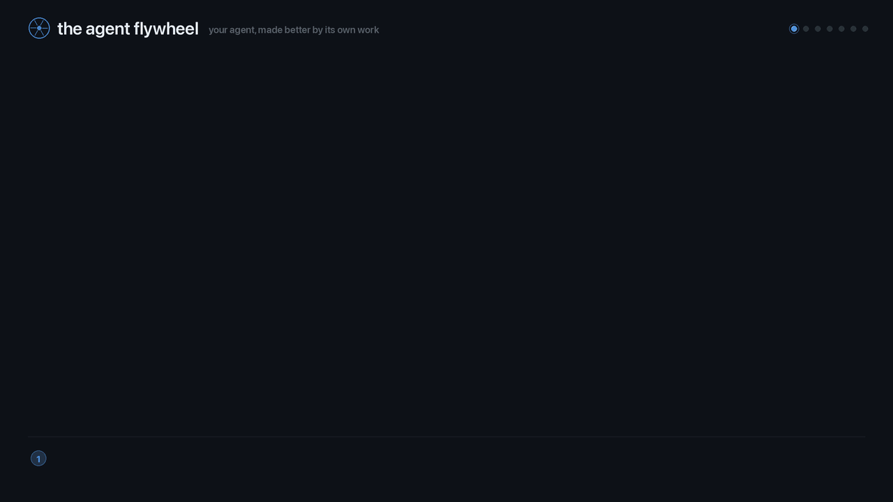

<div align="center">

<!-- FIGURE PATHS ARE RELATIVE, DELIBERATELY — and this is the second time it
     has been settled. They render on GitHub, which is what these GIFs are for.
     Absolute https://raw.githubusercontent.com/... URLs were tried, on the
     reasoning that a registry page cannot resolve a relative path; that broke
     all three figures on github.com instead, because raw.githubusercontent.com
     serves a PRIVATE repo's file to nobody unauthenticated — every reader,
     the owner included. Verified 2026-09-06: all three returned HTTP 404.

     THE TRADE-OFF, so nobody has to rediscover it a third time: relative wins
     while the repo is private and this package is not on npm, because GitHub
     is the only surface anyone reads. Absolute wins on PyPI/npm — and only
     works once the repo is PUBLIC. The two flip together, never separately.

     Held by a test, not by this comment: `test/oss-boundary.test.js` asserts every
      src is relative AND names a file that exists. Shields badges are
     markdown ``, not , and are correctly absolute. -->

#  Agent Flywheel — Node

Built and Maintained by **[PerceptEye](https://percepteye.ai)**

### **Your agent gets better at its own job, on its own work, without you writing a training pipeline.**

**It keeps running in your harness, behind your firewall, on your credentials — unchanged.**<br/>
One plugin. Zero runtime dependencies. Zero lines changed in your agent.

<!-- BADGES — `npm` was a live shields.io version badge and rendered as a red
     "package not found": agent-flywheel is not published to npm
     (verified against the live registry 2026-09-14). It is the only live-data
     badge in this README — every other badge here is a hardcoded shields
     `/badge/` and renders fine — so there is no `ci` badge to fix, and none
     should be added while this repo is private: shields.io queries GitHub
     anonymously and a private repo 404s regardless of what CI did.

     ON PUBLISH restore this one verbatim. Do not hand-write a version into a
     static badge — that asserts a release nothing checks.
       [](https://www.npmjs.com/package/agent-flywheel)

     Separately: the `tests` badge below is hardcoded and nothing checks it
     either; its 434 was true on 2026-09-14 (it had drifted to 373 while the
     suite grew). Re-derive with `npm test` (prints "tests 434" / "skipped 0")
     before trusting it — the Python SDK's equivalent badge had drifted to 54
     short. -->
[](#-develop)
[](package.json)
[](#-why-it-earns-its-place)
[](#-install-in-one-call)
[](#-develop)
[](LICENSE)



**[Install](#-install-in-one-call)** · [How the loop closes](#-how-the-loop-closes) · [Harnesses](#-harnesses) · [Modes](#-two-modes-one-switch) · [Production observability](#-production-observability) · [Human approval](#-a-person-approves-every-change) · [Configuration](#-configuration) · [Python or Node?](#-python-or-node)

</div>

---

**Your agent already does real work. This turns that work into training data, and hands back a model trained on it.**

No container to build. No cluster to run. No GPU to provision. No inbound port to open. No labelling team. No eval suite to write. Your agent does not move — a plugin loads beside it, watches what its tools actually did, and feeds a control plane that does the post-training for you.

<br/>

## 🎯 What you get

| | |
|:--|:--|
| 🔁 **A continual-learning loop** | your agent runs graded tasks, its real outcomes go back, and the next model is trained on *this agent's* work — not a generic benchmark |
| 🤖 **Autonomous post-training** | task generation, grading, dataset construction, training and promotion happen on our side. You build none of it |
| 🧪 **Honest discovery** | the plugin reads the assembled prompt and effective model; current OpenClaw does not expose tools on `llm_input`, so the catalogue stays explicitly incomplete instead of being invented |
| 📈 **Honest telemetry on day one** | your agent's true tool-failure rate, recorded locally, with **no account and no network** |
| 📡 **Production observability** | capture the turns you actually serve — the user's message, the tool calls, the answer — and turn live traffic into evidence |
| ✅ **The approved pair, applied** | training co-optimizes a system prompt alongside the model. Once *a person on your side approves each*, your production install runs **both** — the prompt, and the checkpoint it was certified with. No redeploy; one switch each to stop |
| 🙋 **A person approves every change** | nothing reaches your agent that a human with the operator role did not approve through an explicit control. Not a percentage rollout, not an automated promotion, and never a language model reading "sure, go ahead". [How that is enforced](#-a-person-approves-every-change) |
| 🛡️ **It never touches a tool result** | the recording hook returns `void`. It can never change, block, delay or replace what a tool returns. The two things this plugin *does* change are the system prompt and the model — production mode only, approved bundles only, this agent's own turns only, and off with [`PERCEPTEYE_APPLY_PROMPT=0` / `PERCEPTEYE_APPLY_MODEL=0`](#-two-modes-one-switch) |

<br/>

## ⚡ Install in one call

One package, two harnesses. Pick your line:

```bash
openclaw plugins install agent-flywheel          # OpenClaw
dsh plugin --profile <name> add agent-flywheel   # DeepSeek Harness
```

> [!WARNING]
> **Not on npm yet.** Those two lines are what the install *will* be; today they end in a registry 404, because `agent-flywheel` is not published. Until it is, install from a clone — no build step and no dependencies to fetch:
>
> ```bash
> git clone https://github.com/percepteye-ai/agent-flywheel-node
> openclaw plugins install ./agent-flywheel-node          # OpenClaw
> dsh plugin --profile <name> add ./agent-flywheel-node   # DeepSeek Harness
> ```

**That's the integration.** No import, no wrapper process, no sidecar. Start your agent exactly the way you always did.

Want it to start contributing? Add a key and one host setting:

```bash
export PERCEPTEYE_API_KEY=pefw_...        # optional, and free at https://launch.percepteye.ai
```

**Where a `pefw_` key comes from:** PerceptEye runs the control plane, and signing in is free and self-serve at **[launch.percepteye.ai](https://launch.percepteye.ai)**. Connect your agent there and you get its key — shown once, and scoped to that one agent. Without a key nothing leaves the machine: local recording of your agent's real tool-failure rate works without one, forever.

<!-- THE KEY ROUTE, confirmed by the owner 2026-09-14: PerceptEye operates the
     control plane, and sign-in is free and self-serve at
     https://launch.percepteye.ai (HTTP 200, "Mission Control · PerceptEye").
     Connecting an agent there issues its key -- shown once, bound to that
     agent. The Python README says the same; keep the two in step. -->

```jsonc
// your OpenClaw config
{ "plugins": { "entries": { "agent-flywheel": {
    "hooks": { "allowConversationAccess": true } } } } }
```

That setting does **three** jobs, and every one of them is dropped without it. It lets the plugin read your agent's answer (`agent_end`), describe your agent (`llm_input`), and **point your agent at the approved model** (`before_model_resolve`) — OpenClaw classes all three as conversation hooks and drops them for non-bundled plugins unless you opt in. The plugin **refuses to claim work without it** rather than half-working, and says once, at startup, which capability it is missing and why. Applying the approved *prompt* is the one thing that does **not** need it.

> [!TIP]
> Scalar settings have both an OpenClaw config key and an environment variable, and config wins over the environment. Exact execution evidence is a nested, config-only adapter snapshot. The full table is under [Configuration](#-configuration).

> [!NOTE]
> **Set `agentId` to the OpenClaw agent this install serves** if your host runs more than one. That name is how the control plane knows the agent *and* how the plugin decides whose approved prompt and model to apply. On a host running a single agent — the ordinary install — there is nothing to disambiguate and you can leave it alone. On a host running several with none of them named, the plugin applies **nothing** and says so at startup, because guessing would swap a bystander's prompt.

<br/>

## 🔁 How the loop closes

<p align="center">
  
</p>

| beat | what happens | who does the work |
|:--|:--|:--|
| **⓪ Describe** | the plugin records the assembled prompt and effective model; tools remain `null` on the current host API unless an adapter supplies them | automatic, honestly incomplete |
| **① Claim** | training mode registers this exact worker, then claims one graded task at a time; an exact startup snapshot binds claims to that execution | you dial out — no inbound port |
| **② Run** | the task is delivered into your agent's context, in a dedicated `percepteye-rollout-*` session | your agent, unchanged |
| **③ Record** | every executed tool call lands as `ok` / `failed` / **`unknown`** | the `after_tool_call` hook |
| **④ Report** | the trajectory and answer go back; unsupported evidence stays absent | the plugin |
| **⑤ Train** | tasks generated, rollouts graded, dataset built, policy trained and promoted | **PerceptEye — you build none of it** |
| **⑥ Serve** | the approved system prompt **and** the model it was certified with are applied to your production install automatically, once a person has approved each | the plugin |

That last beat is what makes it a flywheel rather than a pipeline: **the better agent generates the better evidence.**

> [!IMPORTANT]
> **Beat ⑥ closes the pair.** A production install reads `GET /policy/current` and `GET /prompt/current` once at startup and applies **both** halves: the prompt, by replacing the one your host assembled, and the model, by naming a provider this plugin registers whose transport points at the served `base_url`. That matters because they were certified *together* — a prompt applied over some other checkpoint is not the combination anybody evaluated, and the startup log says so plainly whenever only one half lands.
>
> The model half needs two things from your host, and says at startup if it is missing either: `hooks.allowConversationAccess: true`, and a host that accepts the provider registration — the registered provider is the only thing that can supply the served `base_url`, so if the id is refused the model half is refused with it rather than pointing your agent at a provider your host does not know. Separately, if the served endpoint requires a credential it comes from your own `models.providers.percepteye-flywheel.apiKey`.

<br/>

## 🧩 Harnesses

| harness | records outcomes | rollouts | production turn capture | applies the approved prompt | applies the approved model |
|:--|:--|:--|:--|:--|:--|
| **OpenClaw** | ✅ `after_tool_call` | ✅ training mode | ✅ | ✅ `before_prompt_build` | ✅ `before_model_resolve` + a registered provider (needs `allowConversationAccess`) |
| **DeepSeek Harness** | ✅ `tools/result` | — | — | — | — |

**Rollouts are the OpenClaw lane.** DeepSeek Harness exposes no seam for handing a task to a running agent, so on dsh this plugin records outcomes and nothing else, in every mode — it writes to `PERCEPTEYE_TRAJECTORY_DIR` and with that unset it writes nothing.

**This OpenClaw adapter does not claim `llm_call_count`.** The host's public `llm_input` / `llm_output` hooks bracket a whole attempt and expose no provider-call id; one attempt may contain tool loops, retries, or compaction and therefore several provider calls. Counting those hooks or assistant messages would be a guess. The plugin reports no count, and Mission Control excludes the rollout from verified on-policy training even when its gateway has its own count. A future host adapter may use the framework-neutral counter only when its host exposes independently identified per-call start and terminal evidence. DeepSeek Harness also makes no model-call-count claim.

**Every recording hook is structurally incapable of altering a run**: OpenClaw's `after_tool_call` returns `void`, and dsh's `tools/result` is `@mode emit` over deep-frozen objects. The tool-result mutation seams both harnesses expose — result middleware, `tools/post` — are deliberately unused, in every mode. A collector that can corrupt the run it is measuring is worse than no collector.

**The behavior-changing seams are separate from recording.** In production,
`before_prompt_build` returns the approved system prompt and
`before_model_resolve` returns the approved provider and model — beat ⑥ of the
loop rather than telemetry. In training, `before_agent_run` blocks a queued
turn if its lease expired before model submission, and `before_tool_call`
blocks any later side effects after an active lease is revoked. OpenClaw does
not expose an ordinary-plugin API for aborting an already-active model loop,
so that loop may wind down, but it cannot start another tool call or report a
stale result. None of these gates is registered by the production rollout
lane, because that lane does not exist in production mode.

**The registered provider answers for its own id and nothing else.** OpenClaw asks every registered provider plugin to normalise a transport when the matched one declines, so a provider that answered unconditionally would silently redirect your Anthropic or OpenAI traffic. This one returns nothing unless the provider being assembled is `percepteye-flywheel` — the id it registers, and the id it names in `before_model_resolve`.

<br/>

## 🎚 Two modes, one switch

Everything the plugin does beyond local recording is decided by `PERCEPTEYE_AGENT_MODE`.

```bash
export PERCEPTEYE_AGENT_MODE=training     # the default — claim rollouts and run them
export PERCEPTEYE_AGENT_MODE=production   # for the process serving your users
```

| | `training` (default) | `production` |
|---|---|---|
| Records tool outcomes locally | yes | yes |
| Alters a tool result | **never** | **never** |
| Claims rollouts | yes | **no** |
| Puts a task into your agent's context | yes | **no** |
| Starts turns by itself | yes | **no** |
| Captures the turns you serve | n/a | yes |
| Uploads them | n/a | only once an operator enables it |
| **Applies your approved system prompt** | **no** | **yes** — off with `PERCEPTEYE_APPLY_PROMPT=0` |
| **Points your agent at the approved model** | **no** | **yes**, with `hooks.allowConversationAccess: true` — off with `PERCEPTEYE_APPLY_MODEL=0` |

**In `production` the rollout hooks are not registered at all** — the guarantee is the absence of the subscription, not a branch inside a handler that a later edit could invert. **`production` is not "observe-only"**, and this README used to say it was: applying a system prompt and a model changes what the agent does, which is the whole point of beat ⑥. What production mode still guarantees absolutely is that it **claims no work and starts no turn**.

**Both halves apply to this agent's own served turns and to nothing else.** Not to a subagent it spawns, not to a scheduled (cron) turn, and not to another agent in the same gateway. Those are ordinary runs distinguished only by their session key, and the plugin reads the `agentId` and `sessionKey` OpenClaw puts on every hook context to tell them apart. If it cannot tell, it applies nothing.

**In `training` neither half is applied**, deliberately. A rollout is evidence about the agent *as configured*; changing its prompt or its model mid-flight moves the behaviour with no weight change behind it, and the loop would attribute the difference to training.

**In `training` the plugin works the flywheel on its own**, starting each rollout's turn in its own `percepteye-rollout-*` session — never one you are using. If the host closes that seam, it says so once and falls back to delivering the task into the next turn you start; rollouts keep working either way.

`PERCEPTEYE_TRAJECTORY_DIR` names where a **training** rollout's outcomes are written, and the rollout driver sets it per rollout. It is not an off switch. These are:

```bash
export PERCEPTEYE_CAPTURE=0        # register nothing, record nothing, claim nothing
export PERCEPTEYE_APPLY_PROMPT=0   # keep recording, but leave the system prompt alone
export PERCEPTEYE_APPLY_MODEL=0    # keep recording, but leave the model alone
```

All three are also OpenClaw config settings (`capture`, `applyPrompt`, `applyModel`), where config wins over the environment. `PERCEPTEYE_APPLY_PROMPT=0` subscribes no prompt hook at all and does not even fetch the prompt text; `PERCEPTEYE_APPLY_MODEL=0` subscribes no model hook and registers no provider. Your host can also block them from the outside: `plugins.entries.agent-flywheel.hooks.allowPromptInjection: false` stops the prompt half, and simply not setting `allowConversationAccess` stops the model half.

<br/>

## 📡 Production observability

In `production` mode the plugin records the turns your agent is already serving — one directory per turn, in the same on-disk format the Python SDK writes:

```
$PERCEPTEYE_CAPTURE_DIR/<runId>/       # default ~/.percepteye/captured
    turns.jsonl        {"kind":"task"|"answer","text","turn_id","conversation_id","task_id"}
    conversation_id
    task_id            # optional caller-authored case/work-item correlation
    task_id.conflict   # present only when writers disagreed; task_id is then omitted
    tool_calls.jsonl
```

`task_id` is opaque correlation evidence only. The SDK never interprets it as
success, reward, a hint, policy identity, or permission to train. OpenClaw host
adapters may supply it as `taskId`/`task_id` on an event or hook context. Invalid
or conflicting values are omitted rather than cleaned into another identifier;
valid task-only turns still reach the control plane for downstream validation.

**Uploading is off until an operator turns it on, per agent.** A production turn carries *your end users'* messages, so the default cannot be to send them. With a key set, the plugin registers this agent with the control plane at startup — that is what makes it appear so an operator can enable capture — then asks a plain read whether it may upload. It never learns its permission by uploading and finding out. Once enabled, turns go up every 32 turns and again at gateway shutdown.

Recording itself is unaffected by any of that: it never leaves the machine, and works with no account at all.

### The approved pair, applied

With a key set, a `production` install also asks the control plane, **once at startup**, what this agent should be running:

- `GET /policy/current` — which model. **Applied**: the plugin registers a provider (`percepteye-flywheel`), returns it from `before_model_resolve` as the provider and model for the turn, and supplies the served `base_url` through that provider's transport. The startup line still names the `base_url`, model and `serving_generation`, because that is what a fleet cycles a replica on.
- `GET /prompt/current` — the approved system prompt. **Applied**, by replacing the prompt your host assembled, for every attempt.

Once, not per turn: a policy that moves under a running agent splits a process's traffic across two behaviours with nothing recording where the seam was. Restart to pick up a new one — `serving_generation` changes when and only when the answer does.

**What stops the prompt being applied**, each logged with its own reason:

| | |
|:--|:--|
| no API key | the ordinary first install: the control plane is never asked and no hook is subscribed |
| `PERCEPTEYE_APPLY_PROMPT=0` | you switched it off — the hook is not subscribed and the prompt text is not even fetched |
| an empty answer | nothing has passed the approval gate — your prompt stands. It never means "run with no prompt" |
| `stale_baseline` | your own baseline prompt changed after the pair was certified, so the approved text was shaped against a prompt you no longer ship |
| a status that is not `approved`/`delivered` | a draft or pending bundle never serves |
| the bundle disagreeing with itself | its prompt checksum and the checkpoint it was certified against differ — that is not the pair anybody approved |

**And what stops the model being applied**, each with its own reason too:

| | |
|:--|:--|
| no API key | as above — the same one cause, said the same way |
| `PERCEPTEYE_APPLY_MODEL=0` | you switched it off |
| the conversation opt-in missing | `before_model_resolve` is a conversation hook; without `hooks.allowConversationAccess: true` this host never delivers it |
| no provider could be registered | the registered provider is the only thing that can supply the served `base_url`, so if your host has no provider surface or refuses the id, the model half is refused rather than pointing your agent at a provider the host does not know |
| no endpoint served | this agent is on the champion arm, or its candidate is not deployed anywhere — nothing to point at |
| an archive reference as the model | a `gs://` or `s3://` path is a stored artifact, not a name an endpoint can serve; sending it would 404 every completion |

**And either half can be refused for one run rather than for the process** — a subagent turn, a scheduled turn, another agent in the same gateway, or a host that named no agent for the run. Each of those is logged too, once per distinct reason, naming which half and which run.

**The pair check is the line worth reading.** When both halves land, the startup log confirms it: the approved prompt is running on the checkpoint it was certified with, which is the combination that was evaluated. When only one lands, it *warns* and names **which** half is missing and why — because half of a validated combination is not the improvement anybody measured, and an operator who is not told will read the behaviour change as the certified one.

A control plane that is unreachable costs the improvement and nothing else: no answer, no change, no error.

<br/>

## 🙋 A person approves every change

**Both halves of an improvement require a human decision.** Neither the plugin nor the control plane can move your agent on its own, and no language model can approve either one by reading prose.

**The model.** Your agent only leaves the champion arm when **all three** of these hold, and each fails closed back to the champion:

1. **A person with the operator role moves it.** `POST /flywheel-agents/{agent_id}/policy-channel` requires the operator role and a signed-in human identity — the flywheel key your agent uses cannot make this call at all. Rollback is the same call with the other value. No promotion applies it, and there is no percentage rollout that can.
2. **The candidate's certification verdict is not a refusal.** `regressed`, `inconclusive` and `escalated` are all refused — the very same list the promotion gate uses, so an agent can never be served a model the promote path would have rejected.
3. **It is actually deployed somewhere servable.** A stored-artifact reference (`gs://`, `s3://`, `file://`) is refused rather than handed out as a model name.

**The prompt.** A separate chain with its own approval: only a `PromptPairDelivery` whose status is `approved` or `delivered` is ever served, and this plugin re-checks that status itself before applying the text.

**And neither can be approved by a language model reading free text.** `model_promotion`, `prompt_pair_delivery` and `research_promotion` are all classed as irreversible decisions in the control plane, which means only the explicit approve/reject control can resolve them. An interpreted "sure, go ahead" — in a chat thread, in a document, anywhere — never can.

<br/>

## 📄 What it writes

One JSON object per executed tool call, appended to `tool_calls.jsonl`:

```json
{"name":"exec","arguments":{"command":"exit 3"},"outcome":"failed","status_code":null,"error":"(Command exited with code 3)","error_class":"ToolError","latency_ms":155,"agent_name":"main","tool_call_id":"call_percepteye_1"}
```

That line is real output from a live OpenClaw run, and it is the same format the Python SDK writes and reads.

<br/>

## ⚙️ Configuration

Scalar settings are settable two ways: in your OpenClaw config under `plugins.entries.agent-flywheel.config`, or in the environment. **Config wins over the environment**, because config is hot-reloaded and puts a secret under the host's own secret handling, while a gateway reads its environment once at launch. The nested execution snapshot is config-only so component names and completeness remain typed rather than being parsed from a shell string.

| config key | environment variable | default | what it decides |
|:--|:--|:--|:--|
| `apiKey` | `PERCEPTEYE_API_KEY` | *(none)* | the consent boundary. Without it nothing leaves the machine: no registration, no claim, no report, no control-plane read |
| `mode` | `PERCEPTEYE_AGENT_MODE` | `training` | `training` claims rollouts and drives turns; `production` claims none and starts none, captures the turns you serve, and applies the approved pair. An unreadable value degrades to `production` and says so |
| `agentId` | `PERCEPTEYE_AGENT_ID` | `openclaw` | the agent name this install reports as, **and** which OpenClaw agent's approved prompt and model it applies. Set it if your host runs more than one agent |
| `controlPlaneUrl` | `PERCEPTEYE_CONTROL_PLANE_URL` | `https://launch.percepteye.ai/api/flywheel/v1` | the control plane this install talks to |
| `capture` | `PERCEPTEYE_CAPTURE` | on | `0`/`false`/`no`/`off` registers no hooks and records nothing, in either mode |
| `applyPrompt` | `PERCEPTEYE_APPLY_PROMPT` | on | `0` subscribes no prompt hook and does not fetch the prompt text |
| `applyModel` | `PERCEPTEYE_APPLY_MODEL` | on | `0` subscribes no model hook and registers no provider |
| `executionSnapshot` | *(config only)* | *(none)* | opaque SHA-256 components from the host adapter, its completeness assertion, and optionally an exact startup prompt/tool/provider/model observation. Exact startup evidence binds registration and claims to the same SDK-authored execution identity later reported; missing, invalid, lossy, or conflicting evidence abstains |

The snapshot contains `adapterName`, `executionIdentityComplete: true`, and a non-empty `executionComponents` object whose values are lowercase SHA-256 digests. An adapter that can resolve the full execution before work is claimed may also provide `startupObservation: {systemPrompt, tools, provider, model}`. Core runs startup and per-run evidence through the same canonical descriptor; it never accepts a caller-authored final digest. Component names belong to the adapter, and core does not assign them meaning. The resulting `execution_sha256` identifies the observed execution scaffold, not the serving policy, and this package does not generate training hints; those decisions belong downstream where evidence from multiple turns can be compared.

Three more environment variables name directories rather than switching anything. `PERCEPTEYE_HOME` relocates everything this package writes (default `~/.percepteye`); `PERCEPTEYE_CAPTURE_DIR` overrides just the production turn capture (default `$PERCEPTEYE_HOME/captured`); and `PERCEPTEYE_TRAJECTORY_DIR` names where a training rollout's outcomes go, which the rollout driver sets per rollout.

One host setting is not ours and has no environment form: `plugins.entries.agent-flywheel.hooks.allowConversationAccess`, which OpenClaw itself requires before it will deliver conversation hooks to a non-bundled plugin. See [Install](#-install-in-one-call).

<br/>

## ✨ Why it earns its place

- 🪶 **Zero runtime dependencies.** Node builtins only — no version conflict imposed on a customer who did not ask for one, enforced by a CI job.
- 🔌 **Kill switches that really are ones.** `PERCEPTEYE_CAPTURE=0` subscribes no hooks and records nothing; `PERCEPTEYE_APPLY_PROMPT=0` subscribes no prompt hook and does not even fetch the prompt text; `PERCEPTEYE_APPLY_MODEL=0` subscribes no model hook and registers no provider. In every case the guarantee is the absence of the subscription, not a branch inside a handler.
- ⚖️ **It applies an approved pair, or says why it did not.** Every refusal names its own cause rather than one message covering all of them — and when only one half lands it warns and names *which*, because half of a certified combination is not the improvement that was measured.
- 🎯 **One agent's approval changes one agent.** The approved prompt and model reach that agent's own served turns and nothing else — not its subagents, not its scheduled turns, not another agent in the same gateway. Where identity cannot be established, nothing is applied.
- 🎯 **`unknown` is a real answer** — a tool call whose verdict nobody stated is never rounded up to `ok`, because a failure scored as a success is training data that teaches the model the failure was fine.
- 🤝 **One on-disk format across both SDKs**, kept honest by a shared contract schema ([`schema/flywheel-1.json`](schema/flywheel-1.json)) and a test that asserts this package's wire types match it.
- 🧯 **It degrades, it doesn't fail.** A missing key, an unreachable control plane, a closed host seam — each costs the feature that needed it and says so once. Local recording keeps running.
- 🔒 **Every lane is opened from your side.** There is no listening socket anywhere in this package.

<br/>

## 🐍 Python or Node?

**Pick one.** Two implementations of the same flywheel for two different homes — install whichever matches the harness your agent already runs in, never both.

| | this package | [`agent-flywheel`](https://github.com/percepteye-ai/agent-flywheel) (Python) |
|---|---|---|
| **you have** | an OpenClaw or DeepSeek Harness agent | a Python agent, or a CLI agent you launch yourself |
| **you install** | a harness plugin | a pip package — `pip install agent-flywheel` |
| **you change** | nothing — the harness loads it | nothing — one import, one call |
| **the approved prompt** | applied for you — the plugin *is* your host's prompt seam | handed back by `current_prompt()` for you to apply; a library in someone else's process has nowhere to put it |
| **the approved model** | applied for you — the plugin registers a provider and points the turn at it | handed back as an endpoint for you to call |

<br/>

## 🛠 Develop

```bash
npm test     # 434 tests, no install step — node:test, zero dependencies
```

The suite includes payloads captured verbatim from a live OpenClaw run (`test/host-fixtures.test.js`). If a future OpenClaw changes the shape, those fail — rather than someone discovering it months later from bad training data.

---

MIT — see [LICENSE](LICENSE) · security reports: **security@percepteye.ai** · issues and PRs welcome at [agent-flywheel-node](https://github.com/percepteye-ai/agent-flywheel-node/issues).
